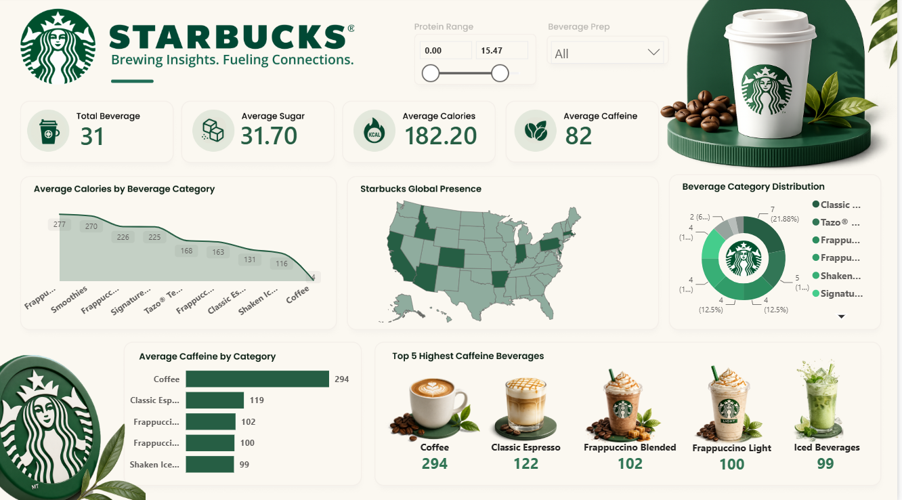
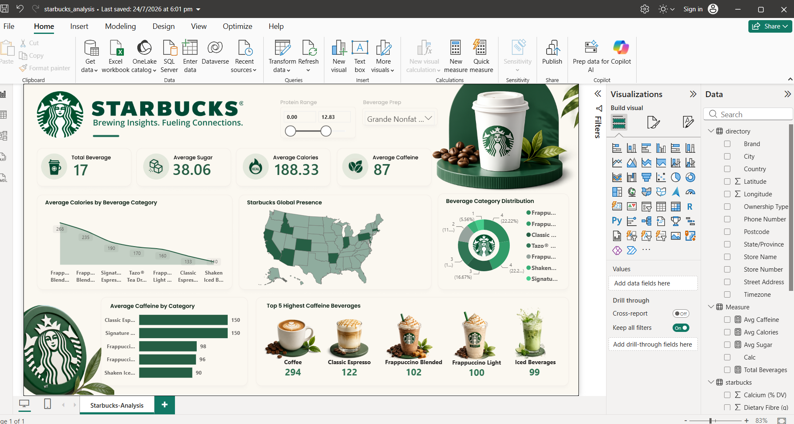

# Starbucks Beverage Analysis | Power BI

## Project Overview
An interactive Power BI dashboard analysing Starbucks
beverage nutrition and store-location data.

## Objectives
- Analyse average calories, sugar and caffeine.
- Compare beverage categories.
- Identify beverages with high caffeine content.
- Explore Starbucks store presence geographically.

## Tools Used
- Power BI Desktop
- DAX
- Data visualisation

## Datasets
- **starbucks:** 240 rows containing beverage and
  nutritional information.
- **directory:** 25,601 rows containing store and
  location information.

The datasets are analysed independently.

## Dashboard Features
- KPI cards for beverage count, sugar, calories and caffeine.
- Average calories by beverage category.
- Starbucks store-location map.
- Beverage category distribution.
- Caffeine comparison and Top 5 beverage visual.
- Interactive report filters.

## DAX Measures

# DAX Measures — Starbucks Analysis

## 1. Average Caffeine
```dax
Avg Caffeine =
AVERAGE(starbucks[Caffeine (mg)])
```
Calculates the average caffeine content across the
currently filtered beverage records.

## 2. Average Calories
```dax
Avg Calories =
AVERAGE(starbucks[Calories])
```
Calculates the average calories per beverage
within the current filter context.

## 3. Average Sugar
```dax
Avg Sugar =
AVERAGE(starbucks[ Sugars (g)])
```
Calculates the average sugar content per beverage
within the current filter context.

## 4. Total Beverages
```dax
Total Beverages =
DISTINCTCOUNT(starbucks[Beverage])
```
Counts unique beverage names, respecting the
current report filters.

## Data Sources
- starbucks: 240 rows
- directory: 25,601 rows

## Notes
Average measures exclude blank values in their
numeric columns. DISTINCTCOUNT can count a blank
beverage value as a distinct value.


## Dashboard Preview



## How to View
Download the `.pbix` file and open it in Power BI Desktop.

## Data Source
Add the original dataset source and licence information here.
